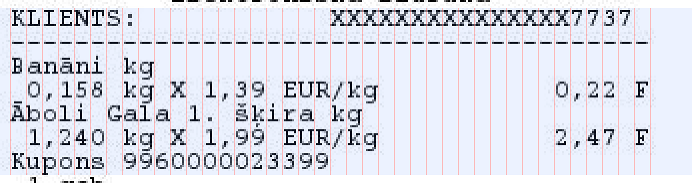

# How it works

## The input

The PDF attached to a Rimi e-receipt e-mail has one page with one image: a JPEG, **346 px wide**, as tall as
the receipt. There is no text layer. The image is produced by the cash register software, so it is
perfectly aligned, noise-free apart from JPEG compression, and every receipt uses exactly the same font
and geometry.

## The grid

The body text is a monospaced font with serifs (similar to Courier) on a fixed grid:

| | |
|---|---|
| columns | 40 per line |
| cell width | 8 px, the first column starts at `x = 5` |
| line pitch | 12 px |
| inside a cell | row 0 — dots and small accents; rows 1–8 — capitals down to the baseline (row 8); rows 9–11 — descenders |
| inter-character gap | the first and last pixel column of each cell |

Two details make the grid less trivial than it looks:

- **Glyphs are 14 px tall, not 12.** Accents above capitals (`Š`, `Ā`, `Č`, `Ž`, `Ū`, `Ī`) are drawn in
  rows −2..−1, i.e. inside the bottom two rows of the line above, where that line's descenders and
  cedillas (`g`, `p`, `ķ`, `ļ`, `ņ`) live. Neighbouring lines therefore overlap by two pixel rows. A naive
  OCR either merges the lines or loses the accents; this is the main reason generic OCR misreads Latvian
  receipt text.
- **Lines have their own phase.** Large headings (the logo, *"Tavs ietaupījums"*, the big total next to
  *"Samaksai EUR"*) are not multiples of 12 px tall, so every block after them starts at a different
  vertical offset. Header lines are centred *by pixel*, so their horizontal offset can be anything from
  0 to 7 px.

## Step 1 — finding the lines

For every vertical position `y` and every horizontal phase `dx ∈ 0..7`, the line is cut into 40 cells and
each cell is compared with the nearest template, looking only at the **core rows 0–9**, which no
neighbouring line can touch. The sum (with a cap per cell, so one unknown character does not disqualify a
line) is the cost of "a text line starts at `y`".

Dynamic programming over `y` then chooses a set of non-overlapping lines (≥ 12 px apart) that minimises

    Σ cost(line) + 0.6 × (ink not covered by any chosen line)

Body-text lines are cheap to explain, so they are taken; the logo and large headings match nothing, so
leaving them uncovered is cheaper. This handles phase changes, centred lines and blank gaps without any
hand-written layout rules.

## Step 2 — decoding the characters

Each non-blank cell (14 × 8 px, rows −2..11) is compared with all templates by L1 distance.

- **Pass 1, top to bottom.** The line above is already decoded, so its rendering is subtracted from rows
  −2..−1 of the current cell before comparing. Rows 10..11 are compared one-sided (only *missing* ink is
  penalised), because accents of the next line may legitimately be there.
- **Pass 2.** Now both neighbours are known. Adjacent lines always have different parity, so all even
  lines are rendered into one page and all odd lines into another; for each line the opposite-parity page
  is subtracted and all 14 rows are compared.

A cell whose best distance exceeds a threshold is returned as `�` (unknown). For each character the
**margin** — the distance gap to the best template of a different character — is kept: a small margin
means an uncertain decision and is reported in `Receipt.low_confidence`. On ~1,000 real receipts 99.96 %
of characters have a margin above 1.0 (typical template distance is ~2).

### Things the font cannot tell apart

`0` and `O` are pixel-identical. The recogniser always returns `0`; the parser replaces it with `O` inside
words that have no digit neighbours (`K0PĀ` → `KOPĀ`, `BEZK0NTAKTA` → `BEZKONTAKTA`, but `50gab` stays).

`k`/`ķ`, `l`/`ļ`, `n`/`ņ` differ only by a 2–3 pixel cedilla in the overlap rows. Pass 2 resolves them
reliably, but they are the characters you will most often see among the low-confidence ones.

## Step 3 — parsing

The recognised lines are split into blocks at the dashed separators:

| Block | Content |
|---|---|
| header | company, legal address, store, register (*Kase Nr.*), VAT number |
| items | name lines (wrapped at 30 characters), a quantity line ` 2 gab X 1,09 EUR   2,18 A` or ` 0,996 kg X 0,99 EUR/kg   0,99 F`, optionally ` Atl. -0,40   Gala cena 1,78`; corrections after `--Korekcija--`; scanned coupons (`Kupons …` / ` 1 gab.`) |
| ATLAIDES | discounts: promotions by item name, *Citas akcijas* (other promotions, summed), receipt-level ones (*Izmantotā Mans Rimi nauda*, *Izmantots Rimi eiro kupons*) |
| card slip | present for card payments; *KOPĀ* here is the **card amount**, not the receipt total |
| Mans Rimi | loyalty money earned, balance, savings this month |
| VAT table | per rate: gross, net, VAT |
| payments | *Bankas karte*, *Skaidra nauda*, *Depozīta kupons*, *Atlikums* (change) … |
| footer | document number, fiscal number, receipt number `#…`, timestamp |

## Step 4 — validation

See the table in the [README](../README.md#what-is-validated). The checks overlap on purpose: a misread
digit in an item price breaks *quantity × price*, the VAT sum and the payment sum at the same time, so it
cannot slip through by accident.

The receipt **total** is computed as Σ item amounts + Σ discounts; the VAT table and the payments must
both equal it. *KOPĀ* is only compared with the card payment, because it is printed on the bank terminal
slip and excludes cash and deposit coupons.

## Performance

About 0.3 s per receipt on a laptop, most of it in line finding (40 cells × 8 phases × every `y`, as one
matrix product per position). `rimi-receipts check` uses all CPU cores.
